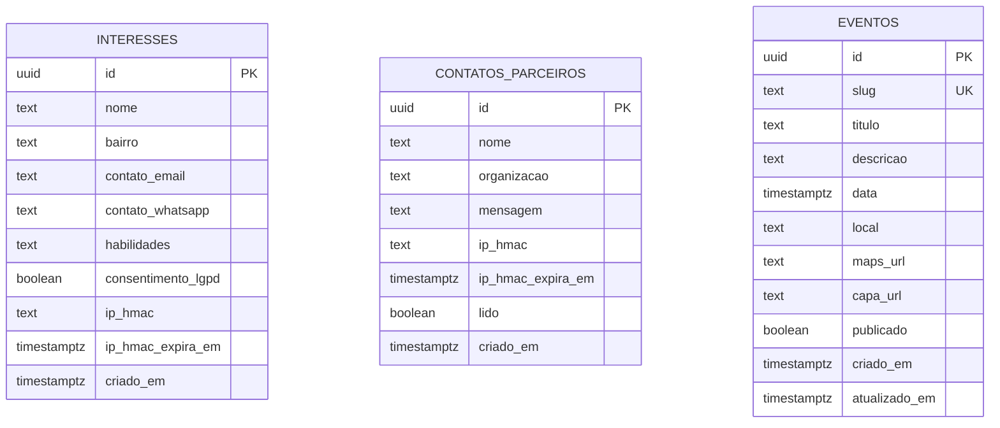
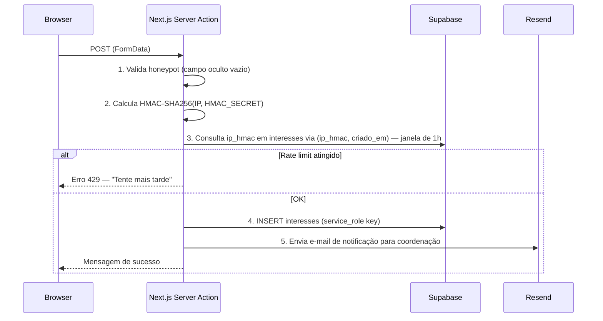
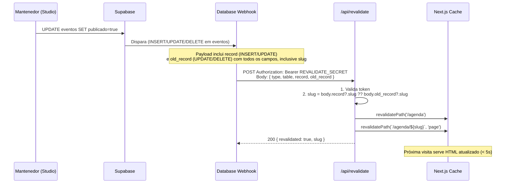

# Arquitetura de Dados — Fase 1 (MVP)

> **Projeto:** Manifesto da Sul  
> **Autoria:** @architect (Aria) · Oct 2026  
> **Migration:** [`supabase/migrations/20261015000001_fase1_mvp.sql`](../../supabase/migrations/20261015000001_fase1_mvp.sql)  
> **Fonte:** [`docs/stories/fase-1-mvp.md`](../stories/fase-1-mvp.md)

---

## Diagrama de entidades



---

## Políticas RLS por papel

| Tabela | anon + authenticated | service_role |
|---|---|---|
| `interesses` | ❌ sem acesso | ✅ full (bypassa RLS) |
| `contatos_parceiros` | ❌ sem acesso | ✅ full |
| `eventos` | 👁️ SELECT `WHERE publicado=true AND data >= now()-1h` | ✅ full |

> **Por que sem policy INSERT para anon ou authenticated?**  
> Os formulários da Fase 1 usam **Server Actions** Next.js com `SUPABASE_SERVICE_ROLE_KEY` (variável de ambiente servidor). O cliente browser nunca recebe essa chave. Isso elimina o risco de abuso da API pública do Supabase por qualquer role.

> **Funções:** `set_atualizado_em()` e `cleanup_ip_hmac_vencidos()` têm `set search_path = ''` (previne _search_path injection_) e `EXECUTE` revogado de `public`, `anon` e `authenticated`. A função de limpeza **não** usa `security definer` — roda com os privilégios do caller (pg_cron como superuser no Supabase).

---

## Fluxo: formulário "Faça parte" (US-04)



---

## Fluxo: revalidação da agenda (US-06)



**Extração do slug na rota `/api/revalidate`:**

```typescript
// src/app/api/revalidate/route.ts
export async function POST(req: Request) {
  const auth = req.headers.get('authorization')
  if (auth !== `Bearer ${process.env.REVALIDATE_SECRET}`) {
    return Response.json({ error: 'Unauthorized' }, { status: 401 })
  }
  const body = await req.json()
  // record presente em INSERT e UPDATE; old_record em UPDATE e DELETE
  const slug: string | undefined = body.record?.slug ?? body.old_record?.slug
  revalidatePath('/agenda')
  if (slug) revalidatePath(`/agenda/${slug}`, 'page')
  return Response.json({ revalidated: true, slug })
}
```

---

## Job pg_cron: limpeza do ip_hmac

| Job | Schedule | Ação |
|---|---|---|
| `cleanup_ip_hmac_diario` | `0 6 * * *` (03h BRT) | Nulifica `ip_hmac` e `ip_hmac_expira_em` onde `ip_hmac_expira_em < now()` |
| `cleanup_webhook_logs` | `0 7 * * *` (04h BRT) | Deleta `webhook_logs` com mais de 7 dias |

> **Por que nulificar em vez de deletar o registro?**  
> O interesse (nome, bairro, contato) continua disponível para a coordenação via e-mail e para o mantenedor no Studio. Apenas a informação de rastreamento (IP anonimizado) é removida após 30 dias, conforme a política de privacidade (US-07).

---

## Variáveis de ambiente necessárias

| Variável | Onde usar | Descrição |
|---|---|---|
| `NEXT_PUBLIC_SUPABASE_URL` | Cliente + Servidor | URL do projeto Supabase |
| `NEXT_PUBLIC_SUPABASE_ANON_KEY` | Cliente | Chave anon (SELECT em eventos publicados) |
| `SUPABASE_SERVICE_ROLE_KEY` | **Servidor apenas** | Chave service_role para INSERT via Server Actions |
| `HMAC_SECRET` | **Servidor apenas** | Segredo para HMAC-SHA256 do IP (mín. 32 bytes aleatórios) |
| `REVALIDATE_SECRET` | **Servidor apenas** | Token Bearer para o endpoint `/api/revalidate` |
| `CONTACT_EMAIL` | **Servidor apenas** | E-mail de destino das notificações Resend |
| `RESEND_API_KEY` | **Servidor apenas** | Chave da API do Resend |

> [!CAUTION]
> `SUPABASE_SERVICE_ROLE_KEY`, `HMAC_SECRET` e `REVALIDATE_SECRET` **nunca** devem ser expostas ao cliente. No Next.js App Router, variáveis sem o prefixo `NEXT_PUBLIC_` são automaticamente server-only.

---

## Instruções: configurar o Database Webhook

O webhook não pode ser criado por SQL — configure via **Supabase Dashboard**:

1. Acesse **Database → Webhooks → Create a new hook**
2. Preencha:
   - **Name:** `revalidate_agenda`
   - **Table:** `public.eventos`
   - **Events:** `INSERT`, `UPDATE`, `DELETE`
   - **Method:** `POST`
   - **URL:** `https://<dominio>/api/revalidate`
   - **HTTP Headers:** `Authorization: Bearer <REVALIDATE_SECRET>`
3. Salve e teste com um UPDATE em um evento.

Alternativa via CLI (Supabase CLI v1.200+):
```bash
supabase webhooks create \
  --name revalidate_agenda \
  --table eventos \
  --events insert,update,delete \
  --url https://<dominio>/api/revalidate \
  --header "Authorization=Bearer $REVALIDATE_SECRET"
```

---

## Instruções: rodar a migration e o seed

```bash
# Desenvolvimento local — aplica migrations + seed.sql automaticamente
supabase db reset

# Produção — aplica apenas as migrations (seed.sql não é incluído)
supabase db push

# Ou via Dashboard: Database → SQL Editor → cole o .sql → Run
```

> [!NOTE]
> **pg_cron** precisa estar habilitado antes de rodar a migration. Acesse **Database → Extensions → pg_cron → Enable**.

> [!IMPORTANT]
> O arquivo [`supabase/seed.sql`](../../supabase/seed.sql) contém apenas dados de desenvolvimento (evento de exemplo com `publicado=false`). Nunca é executado pelo `supabase db push` — apenas pelo `supabase db reset`.

---

## Próximos passos

1. **@dev** → implementar `src/app/api/revalidate/route.ts` e Server Actions dos formulários.
2. **@devops** → configurar variáveis de ambiente no Vercel (Settings → Environment Variables).
3. **@qa** → testar rate limiting (3 envios/h), RLS (anon sem INSERT), revalidação (< 5s após UPDATE).
4. **Mantenedor** → habilitar `pg_cron` no Dashboard + configurar webhook `revalidate_agenda`.
